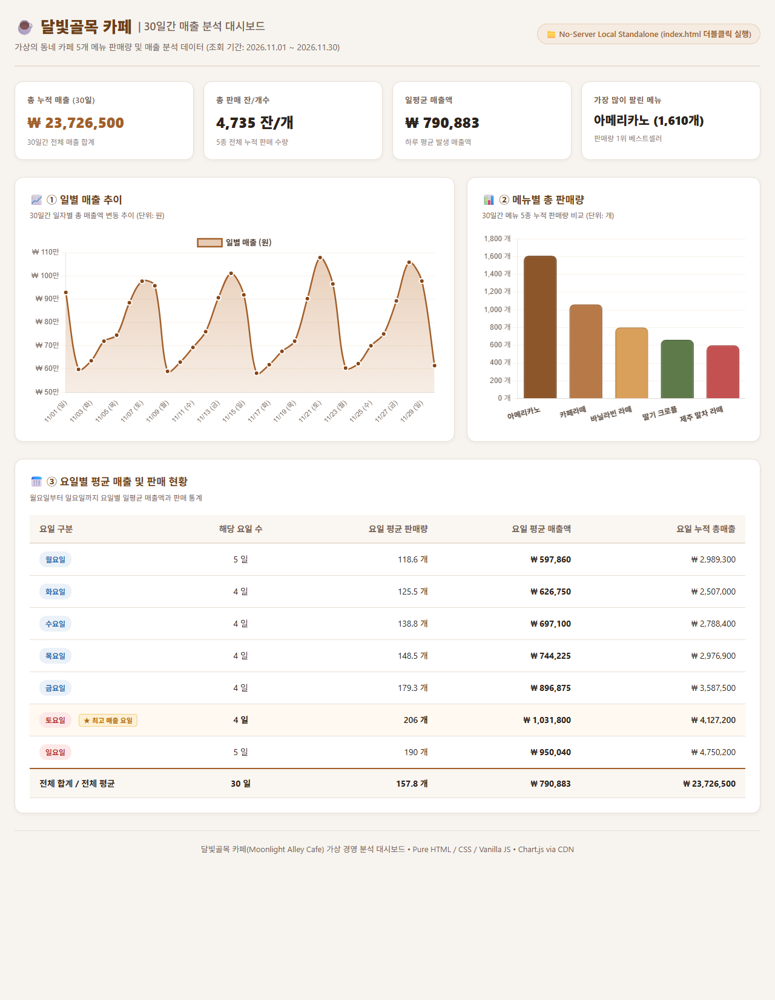

# ☕ 달빛골목 카페 (Moonlight Alley Cafe) - 매출 대시보드

가상의 동네 카페 30일간(2026.11.01 ~ 11.30) 5종 메뉴 판매량 및 매출 분석 인터랙티브 웹 대시보드입니다.



---

## 📌 주요 특징
- **No-Server / Zero Install**: 별도 웹 서버나 라이브러리 설치 없이 `index.html` 더블클릭만으로 로컬 브라우저에서 바로 실행
- **경량 아키텍처**: 순수 HTML5, CSS3, 바닐라 JavaScript 및 Chart.js (CDN) 기반
- **가상 데이터 내장**: `data.js` 내에 30일치 메뉴 5종 판매량 및 매출 데이터가 자바스크립트 변수로 내장 (외부 CSV 종속성 없음)

---

## 📁 파일 구조
```text
OWW4/
├── index.html               # 메인 대시보드 UI (헤더, KPI 카드, 차트, 요일별 통계 표)
├── data.js                  # 30일간 5개 메뉴 가상 판매 데이터 (변수 정의)
├── chart.js                 # Chart.js 렌더링 및 데이터 집계 스크립트
├── dashboard_screenshot.png # 실행 화면 캡처 이미지
└── README.md                # 프로젝트 안내 문서
```

---

## 🚀 실행 방법
1. 저장소를 클론하거나 다운로드합니다:
   ```bash
   git clone https://github.com/lyxs-9ll/OWW4.git
   ```
2. `index.html` 파일을 더블클릭하여 브라우저(Chrome, Edge, Safari 등)에서 엽니다.

---

## 📊 주요 대시보드 기능
1. **상단 KPI 요약 카드**:
   - 30일간 총 누적 매출액 (₩ 23,726,500)
   - 5종 메뉴 총 판매 수량 (4,735 잔/개)
   - 일평균 매출액 (₩ 790,883)
   - 베스트셀러 1위 메뉴 (아메리카노, 1,610잔)
2. **📈 ① 일별 매출 꺾은선 차트**:
   - 30일간 일자별 총 매출 추이 곡선 및 주말/주중 매출 변동 분석
3. **📊 ② 메뉴별 총 판매량 막대 차트**:
   - 5개 메뉴(아메리카노, 카페라떼, 바닐라빈 라떼, 제주 말차 라떼, 딸기 크로플) 누적 판매 수량 비교
4. **📅 ③ 요일별 평균 매출 및 판매 현황 표**:
   - 월요일부터 일요일까지 요일별 일평균 판매량, 일평균 매출액, 누적 매출 통계 및 최고 매출 요일(토요일) 하이라이트

---

## 💰 30일간 매출 통계 요약
- **총매출 합계**: **₩ 23,726,500**
- **총 판매량**: **4,735 개**
- **메뉴별 현황**:
  - 아메리카노: 1,610잔 (₩ 6,440,000)
  - 카페라떼: 1,062잔 (₩ 5,097,600)
  - 바닐라빈 라떼: 802잔 (₩ 4,411,000)
  - 딸기 크로플: 663개 (₩ 4,309,500)
  - 제주 말차 라떼: 598잔 (₩ 3,468,400)
